# Maya 플러그인 (MZepeto)

[🇺🇸 English](./maya.md) | 🇰🇷 한국어

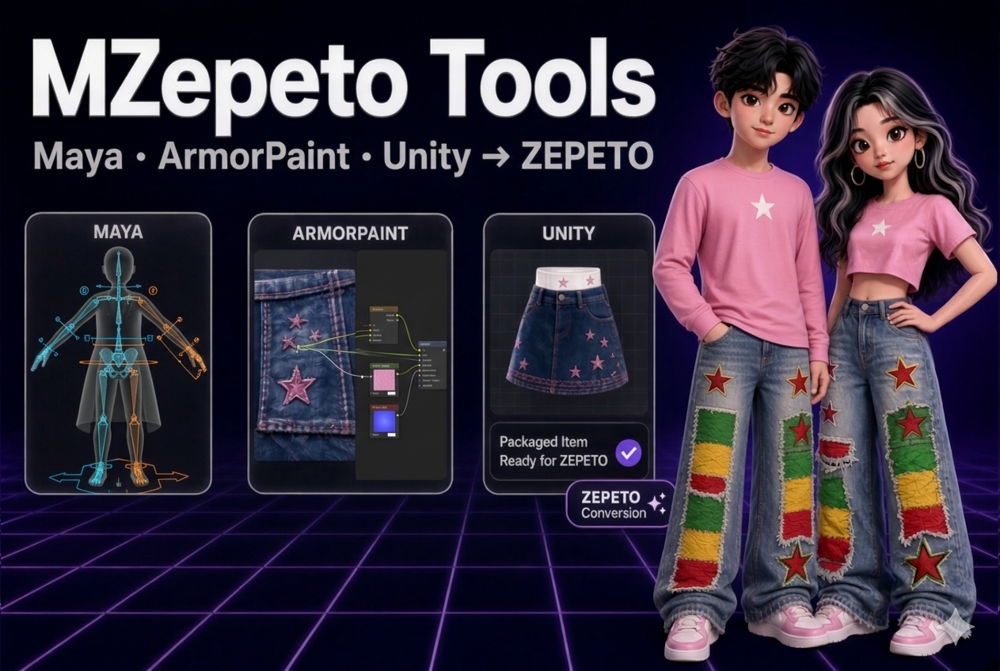

MZepeto 는 BZepeto Blender 애드온의 **Maya 판**입니다. 같은 패널, 같은 버튼, 같은 제페토 검사를 Maya 안에서
씁니다. 아이템은 BZepeto 와 같은 **Unity 패키지**로 넘어가고, 텍스처는 같은 **ArmorPaint** 로 칠합니다.

그림의 빨간 상자가 누를 곳이고, 번호 순서대로 누르면 됩니다.

| | |
|---|---|
| Maya | **Autodesk Maya 2027** (Windows 64비트) |
| Unity | ZEPETO Studio 프로젝트, **Unity 2020.3.9f1** — [Unity 패키지](KO_unity.md) |
| 제페토 베이스 캐릭터 | 제페토 크리에이터 자료의 `creatorBaseSet_zepeto.fbx` — 제페토의 파일이라 **포함되어 있지 않습니다** |

## 1. 받은 파일

검로드에서 받는 파일은 `MZepeto_<버전>.zip` 하나입니다. 이 파일을 풀면 생기는 `MZepeto_<버전>` 폴더에
다음 파일이 있습니다:

| 파일 | 내용 | 설치 |
|---|---|---|
| `mzepeto_maya-<버전>.zip` | Maya 플러그인 | 아래 2번 |
| `com.bzepeto.unity2020-<버전>.tgz` | **ZEPETO Studio(Unity 2020.3.9)** 용 Unity 패키지 — BZepeto 와 같은 파일 | [Unity 페이지](KO_unity.md) 1번 |
| `BZepeto_ArmorPaint_<버전>_win64.zip` | BZepeto 플러그인이 켜진 ArmorPaint — BZepeto 와 같은 파일 | [ArmorPaint 페이지](KO_armorpaint.md) 1번 |
| `SHA256SUMS.txt` | 파일 확인용 체크섬 | — |

BZepeto 를 이미 쓰고 있다면 Unity 패키지와 ArmorPaint 는 같은 것이므로 다시 설치하지 않아도 됩니다.

## 2. 설치

1. `mzepeto_maya-<버전>.zip` 을 풉니다. 안에 있는 **`MZepeto` 폴더**를 계속 둘 곳에 옮깁니다 — 예: `C:\MZepeto`
2. Maya 2027 을 실행합니다
3. `MZepeto` 폴더 안의 **`install.mel` 을 Maya 뷰포트로 끌어다 놓습니다**
4. 끝입니다. 메뉴 막대에 **MZepeto** 메뉴 **①**, 셸프에 **MZepeto** 탭 **②** 이 생기고, 그다음부터는 Maya 를
   켤 때마다 플러그인이 자동으로 켜집니다

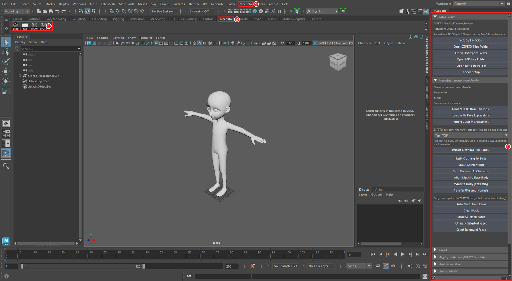

**①** MZepeto 메뉴 **②** MZepeto 셸프 탭 **③** 셸프 버튼 **④** MZepeto 패널(오른쪽에 붙인 모습)

!!! warning "폴더 경로는 영문으로"
    Maya 는 경로에 한글 같은 영문 외 글자가 있으면 플러그인을 읽지 못합니다. `C:\MZepeto`, `D:\Tools\MZepeto`
    처럼 **영문·숫자만 있는 경로**에 두세요. 설치 프로그램이 한글 경로를 알아보고 멈추며 이유를 알려 줍니다.
    (Maya 설정 폴더가 `OneDrive\문서` 에 있는 것은 괜찮습니다.)

**셸프 버튼** **③**

| 버튼 | 하는 일 |
|---|---|
| **Load** | 플러그인을 켭니다(자동으로 켜지지 않았을 때) |
| **MZ** | MZepeto 패널을 엽니다 |
| **BrON** / **BrOFF** | Unity 라이브 브리지를 켜고 끕니다 |

**Maya 보안 창** — Maya 2027 이 처음 플러그인을 읽을 때 *"이 플러그인을 신뢰하시겠습니까?"* 를 물으면
**Allow**(허용)를 누르세요. 거부하면 MZepeto 메뉴가 생기지 않습니다.

**설치가 하는 일** — Maya 의 `modules` 폴더에 `MZepeto.mod` 파일 하나를 만들어 MZepeto 폴더를 가리키게 합니다.
파일을 복사하지 않습니다. 그래서:

- **폴더를 옮겼다면** 새 위치의 `install.mel` 을 다시 끌어다 놓으세요
- **업데이트**는 새 버전을 같은 폴더에 덮어 풀고(또는 새 폴더에 풀고 그 `install.mel` 을 끌어다 놓고) Maya 를
  다시 시작하면 됩니다
- **삭제**는 Script Editor 의 Python 탭에서 아래를 실행한 뒤 MZepeto 폴더를 지웁니다

```python
import mzepeto.install; mzepeto.install.uninstall()
```

## 3. 처음 설정 (Setup)

Blender 애드온은 이 설정을 애드온 환경 설정에 두었지만, Maya 에는 그런 곳이 없어서 **MZepeto > Setup / Folders...**
가 같은 설정 창을 엽니다(패널의 Setup 칸 맨 위 버튼도 같음). **한 번 저장해 두면 모든 버튼이 이 경로를 써서 파일 창이
뜨지 않습니다.**

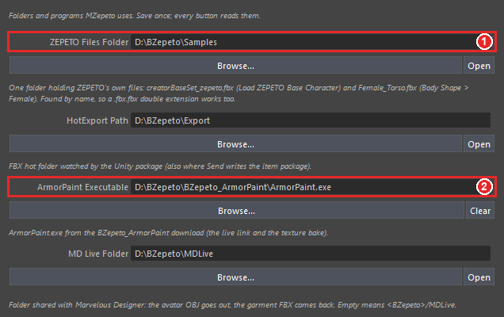

1. **ZEPETO Files Folder** **①** — 제페토 파일을 모아 두는 폴더입니다. 여기에 제페토의
   `creatorBaseSet_zepeto.fbx`(베이스 캐릭터)와 `Female_Torso.fbx`(Body Shape > Female 용 여성 레퍼런스)를 두세요.
   이름으로 찾으므로 `Female_Torso.fbx.fbx` 처럼 받아진 이름도 됩니다
2. **ArmorPaint Executable** **②** — ArmorPaint 를 푼 폴더의 `ArmorPaint.exe` ([ArmorPaint 설치](KO_armorpaint.md))
3. 나머지 폴더는 비워 두면 기본값을 씁니다(아래 표). 각 칸 아래의 작은 글씨가 그 칸의 용도입니다.
   **Browse...** 로 고르고, **Open** 은 그 폴더를 탐색기로 엽니다

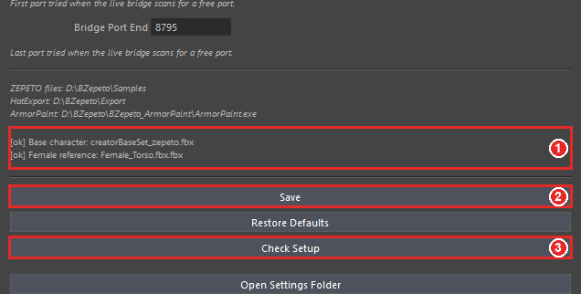

4. 아래에 두 제페토 파일을 찾았는지 **①** `[ok]`(찾음) / `[--]`(없음) 으로 나옵니다
5. **Save** **②** — 저장합니다. **Check Setup** **③** 은 모든 경로를 검사해 Script Editor 에 적습니다

| 설정 | 비워 두면 | 쓰는 곳 |
|---|---|---|
| ZEPETO Files Folder | `%USERPROFILE%\BZepeto\Samples` | Load ZEPETO Base Character, Body Shape > Female |
| HotExport Path | `%USERPROFILE%\BZepeto\HotExport` | Send to Unity, Export FBX, ArmorPaint 라이브 링크 |
| ArmorPaint Executable | — | Paint in ArmorPaint, Pull Textures |
| MD Live Folder | `%USERPROFILE%\BZepeto\MDLive` | MD Live |
| Renders Folder | `%USERPROFILE%\BZepeto\Renders` | Studio Render |
| Body Shape Presets | `%USERPROFILE%\BZepeto\Presets\BodyShape` | 체형 프리셋 저장·불러오기 |
| Bridge Port Start / End | 8765 / 8795 | Unity 라이브 브리지 |

설정 파일은 BZepeto 와 같은 `%USERPROFILE%\BZepeto\settings.json` 입니다. **HotExport** 는 Unity 패키지가 지켜보는
폴더라서 기본값 그대로면 Unity 쪽은 따로 설정할 것이 없습니다.

## 4. MZepeto 패널

Blender 는 애드온을 3D 뷰의 사이드바 탭(N)에 그리지만, Maya 에는 그런 사이드바가 없어서 같은 패널들을 **도킹 패널**
하나에 그립니다. **MZepeto > Open MZepeto Window** 또는 셸프의 **MZ** 로 엽니다.

- **처음에는 떠 있는 창**으로 열립니다. 창의 제목 탭을 끌어 Maya 화면 가장자리(오른쪽 등)에 놓으면 붙고, Channel Box·
  Attribute Editor 옆에 놓으면 **탭으로 합쳐집니다** — Maya 의 기본 패널과 같은 방식입니다
- Maya 가 붙인 위치를 기억해서 **다음에 열 때 그 자리**에 다시 나옵니다. Setup 창도 같은 방식으로 붙일 수 있습니다
- 패널은 Blender 패널마다 **접히는 칸** 하나씩입니다: Setup, Wearables, Export, Rigging, Body Shape, Send to ZEPETO,
  Review Tools, Studio Render, ZEPETO Playground, ArmorPaint, MD Live. 칸 머리줄의 **▸/▾** 로 접고, 접힌 머리줄에도
  핵심 상태(캐릭터 이름, 본 수, 체형 …)가 보입니다
- 패널을 좁게 붙이면 버튼이 폭에 맞게 줄어듭니다. 잘린 긴 글줄은 **마우스를 올리면** 전체가 보입니다

모든 버튼은 **MZepeto 메뉴**에도 같은 이름으로 있습니다(Character, Export, Rigging, Weights, Body Shape, Send to
ZEPETO, Review, Studio Render, Playground, ArmorPaint, MD Live, Setup). 메뉴의 점선을 누르면 떼어 내어 띄워 둘 수
있습니다.

## 5. 베이스 캐릭터와 의상 (Wearables)

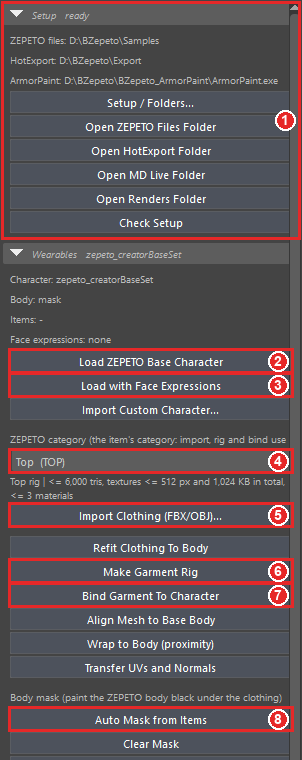

**①** Setup 칸 — 지금 쓰는 경로와 각 폴더 열기. 머리줄에 `ready` 가 보이면 제페토 파일을 찾은 것입니다.

1. **Load ZEPETO Base Character** **②** — 제페토 베이스 캐릭터(104개 뼈, 키 108.65cm, 몸 메쉬 `mask`)를
   불러옵니다
2. 헤드웨어·마스크를 만든다면 대신 **Load with Face Expressions** **③** — 베이스에 제페토 얼굴 표정 249개가
   함께 들어갑니다(아래 9번)
3. **ZEPETO category** **④** 에서 아이템 종류를 고릅니다(예: Top, Skirt, Hair). 아래 줄에 그 카테고리의 리그와
   한도가 나옵니다 — 예: `Top rig | <= 6,000 tris, textures <= 512 px and 1,024 KB in total, <= 3 materials`
4. **Import Clothing (FBX/OBJ)...** **⑤** — 옷 파일을 불러와 고른 카테고리로 캐릭터에 붙입니다
5. **Make Garment Rig** **⑥** → **Bind Garment To Character** **⑦** — 옷에 웨이트를 주고 캐릭터에 바인드합니다.
   바인드한 뒤에도 옷이 **선택된 채로** 남아 다음 버튼을 바로 누를 수 있습니다
6. **Auto Mask from Items** **⑧** — 아이템이 덮는 몸을 검게 칠합니다(제페토가 그 부분을 숨김)

카테고리는 패널에 **하나**만 있습니다: Wearables 와 Send to ZEPETO 의 두 드롭다운은 서로 따라갑니다. Make Garment Rig
는 고른 카테고리를 메쉬에 기록하고, 이미 리깅된 아이템은 자기 카테고리를 유지합니다(바꾸려면 Make Garment Rig 를
다시).

그 밖의 버튼:

| 버튼 | 하는 일 |
|---|---|
| Import Custom Character... | 내 제페토 캐릭터 FBX 를 베이스 대신 불러옵니다 |
| Refit Clothing To Body | 체형을 바꾼 뒤 입은 옷을 몸에 다시 맞춥니다 |
| Align Mesh to Base Body | 선택한 메쉬의 점을 캐릭터 몸에 맞춥니다 |
| Wrap to Body (proximity) | Maya 의 프록시미티 랩으로 메쉬를 몸에 붙입니다(토폴로지는 그대로, 몸을 따라감) |
| Transfer UVs and Normals | UV·노멀·버텍스 컬러를 다른 메쉬에서 복사합니다 |
| Clear Mask / Mask Selected Faces / Unmask Selected Faces | 마스크 지우기, 선택한 면을 숨기기·되살리기 |
| Select Removed Faces | 제페토에서 실제로 지워질 면을 선택합니다 |

**캐릭터가 엄청 크게 보이면** — 베이스는 센티미터로 만들어져 있습니다. Maya 씬 단위가 미터면 108.65cm 가
108.65m 가 됩니다. **Windows > Settings/Preferences > Preferences > Settings > Working Units > Linear** 를
**centimeter** 로 두세요. 불러올 때 단위가 센티미터가 아니면 경고가 나옵니다.

## 6. 리깅 (Rigging)

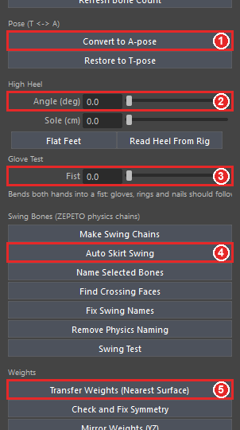

- **본 개수** — 칸 머리줄에 내 리그와 제페토 기본 뼈대(104개) 비교가 보입니다(**Refresh Bone Count** 로 다시 셈)
- **Convert to A-pose** **①** / **Restore to T-pose** — T 포즈와 A 포즈 전환
- **High Heel** **②** — **Angle (deg)** 은 뒤꿈치를 드는 각도, **Sole (cm)** 은 앞창 두께. 발가락은 바닥에
  그대로 있고 몸이 올라갑니다. 신발(Shoes) 아이템을 보낼 때만 제페토 힐 정보가 실립니다. **Flat Feet** 는 힐을 끄고,
  **Read Heel From Rig** 은 불러온 하이힐 아이템의 값을 슬라이더로 가져옵니다
- **Glove Test > Fist** **③** — 양손이 주먹을 쥡니다. 장갑·반지·네일이 손가락을 따라가는지 보는 용도이고,
  내보내기에는 영향이 없습니다

### 스윙 본 (머리카락, 치마, 리본)

- **Auto Skirt Swing** **④** — 치마·원피스·롱코트에 흔들림 본을 한 번에 넣습니다. 카테고리를 Skirt·Dress·
  Outerwear 로 두고 Make Garment Rig → Bind → Auto Skirt Swing 순서로 누르세요
- **Make Swing Chains** — 고른 엣지 줄을 따라 체인을 만듭니다
- 뼈 이름은 제페토 SDK 형식 `<관절>_physics_<drag>_<angle drag>_<restore drag>` 로 붙습니다.
  **Name Selected Bones** 는 선택한 뼈에 이 이름을 붙이고, **Remove Physics Naming** 은 지웁니다
- **Fix Swing Names** — 예전 형식(띄어쓰기)의 흔들림 뼈 이름을 고칩니다
- **Find Crossing Faces** — 옷이 스스로를 뚫는 면을 선택해 줍니다
- **Swing Test** — 모든 체인을 흔들어 실제로 얼마나 움직이는지 알려 줍니다(Maya 전용)

### 웨이트

| 버튼 | 하는 일 |
|---|---|
| **Transfer Weights (Nearest Surface)** **⑤** | 몸의 웨이트를 선택한 옷에 옮깁니다 |
| Check and Fix Symmetry | 좌우 웨이트가 다른 곳을 찾아 고칩니다 |
| Mirror Weights (YZ) | Maya 의 웨이트 미러(YZ 평면) — Maya 전용 |
| Fix Scale Bones | 체형용 `_scale` 뼈가 받아야 할 웨이트를 옮깁니다(제페토 리깅 규칙) — Maya 전용 |
| Limit Influences to 4 | 정점마다 영향 뼈를 4개로 제한 |
| Scan / Delete Unused Bones | 쓰지 않는 뼈를 찾고 지웁니다(제페토 필수 뼈는 보호) |

## 7. 체형 (Body Shape)

- **Body Type** — Base / Female / Male / Imported 중에서 고릅니다. **Rebuild Bust from Reference FBX** 는
  `Female_Torso.fbx` 로 여성 가슴 모양을 다시 만들고, **Import Body from Character** 는 다른 캐릭터의 뼈 배치와 몸을
  가져옵니다
- **슬라이더 8개** — 키, 어깨 너비, 가슴, 허리, 골반, 다리 길이, 목 길이, 머리 크기
- **Store Base Snapshot** 은 지금 상태를 기준으로 저장하고, **Build Body Shape Delta** 는 슬라이더를 리그에 적용해
  체형 차이를 만듭니다
- **Save / Load Body Shape Preset** — 슬라이더 값을 JSON 으로 저장·불러오기(Setup 의 Body Shape Presets 폴더)

## 8. 내보내기 (Export)

- **Run Export Checks** — 내보내기 전 점검 목록을 실행합니다. 결과는 칸 아래(처음에는 *Not checked yet*)와
  Script Editor 에 나옵니다
- **Check and Export FBX** — 검사한 뒤 제페토 설정으로 FBX 를 HotExport 폴더에 내보냅니다
- **Fit to Triangle Budget** — 선택한 메쉬를 카테고리 삼각형 한도까지 줄입니다(Maya 의 polyReduce, Maya 전용)

## 9. Send to ZEPETO

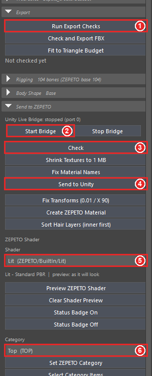

**①** Run Export Checks(Export 칸) **②** Start Bridge **③** Check **④** Send to Unity **⑤** ZEPETO Shader **⑥** Category

1. 아이템을 선택하고 **Category** **⑥** 를 고릅니다(Wearables 의 카테고리와 같은 것)
2. **Check** **③** — 카테고리 한도와 제페토 변환기 규칙으로 검사합니다. 결과는 Script Editor 와 뷰포트 아래에 나옵니다
3. 고칠 것이 있으면 아래 버튼으로 고칩니다:
    - **Shrink Textures to 1 MB** — 텍스처 합계가 1MB 를 넘으면 줄인 사본을 만들어 연결합니다(원본은 그대로)
    - **Fix Material Names** — 머티리얼 이름을 제페토 규칙(`<아이템>_shd`)으로 바꿉니다
    - **Fix Transforms (0.01 / X 90)** — 제페토 아이템 규칙의 스케일·회전을 맞춥니다
    - **Create ZEPETO Material** — 제페토 BuiltIn 머티리얼을 줍니다
    - **Sort Hair Layers (inner first)** — 헤어 카드를 안쪽부터 그리도록 정렬합니다
4. **Send to Unity** **④** — 검사하고, FBX + 마스크 + PNG 텍스처 + 설명 파일을 만들어 Unity 로 보냅니다

**Unity 라이브 브리지** **②** — **Start Bridge** 를 누르면 Unity 와 바로 연결되고, 위 줄에 상태와 포트가 나옵니다.
브리지를 켜지 않아도 Send 는 HotExport 폴더를 거쳐 Unity 로 갑니다([Unity 패키지](KO_unity.md)가 지켜봄).

**ZEPETO Shader** **⑤** — 아이템의 제페토 셰이더를 고릅니다(Lit, Cloth, Fur, HairAlpha, Sparkle, Iridescence,
Prism, CustomEnv, Toon, Detail Normal). 셰이더는 아이템과 함께 Unity 로 가고, 아래 줄에 그 셰이더가 읽는 맵이 나옵니다.

- **Preview ZEPETO Shader** — 아이템 자신의 맵으로 Maya 뷰포트용 미리보기 재질을 만듭니다(Fur·Sparkle·Toon 같은
  효과는 근사치이고, 실제 모습은 Unity·제페토 미리보기가 기준)
- **Clear Shader Preview** — 원래 재질로 정확히 되돌립니다
- **Status Badge On / Off** — 뷰포트에 선택한 아이템의 삼각형/한도, 재질 수, 텍스처 KB, 뼈 수를 한 줄로 계속
  보여 줍니다(Maya 전용)

**Set ZEPETO Category** 는 선택한 아이템에 카테고리를 기록하고, **Select Category Items** 는 그 카테고리 아이템을
모두 선택합니다.

## 10. Review Tools 와 Studio Render

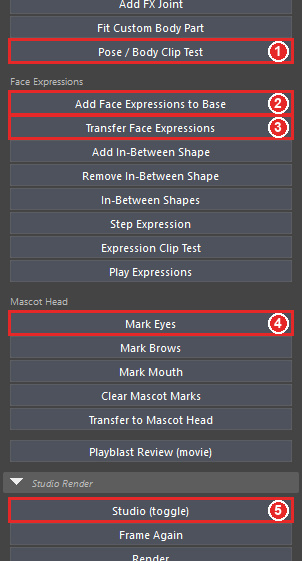

- **Pose / Body Clip Test** **①** — 아이템을 입힌 캐릭터에 제페토 미리보기 포즈를 체형·데포메이션마다 적용해 살이
  아이템을 뚫는 곳을 찾습니다
- **Head Size Test**(앱이 쓰는 가장 작은·큰 머리), **Mark Selected as Front Hair**(잔머리를 맨 앞에), **Add FX
  Joint**(이펙트용 조인트), **Fit Custom Body Part**(여성·커스텀 몸통 맞추기)

**얼굴 표정**

- **Add Face Expressions to Base** **②** — 불러온 베이스에 표정 249개를 만듭니다
- **Transfer Face Expressions** **③** — 얼굴 아이템(헤어, 마스크)을 선택하고 누르면, 아이템이 바로 아래 얼굴을
  따라 움직이는 표정을 받습니다
- **Add / Remove In-Between Shape**, **In-Between Shapes** — 제페토 가이드의 인비트윈 표정(eyeBlink 와 관련
  표정)을 넣고 빼고 목록을 봅니다
- **Step Expression** 은 표정을 하나씩 보여 주고, **Expression Clip Test** 는 표정마다 얼굴이 아이템을 뚫는지·아이템이
  따라가는지 검사하며, **Play Expressions** 는 모든 표정을 타임라인 애니메이션으로 만듭니다

!!! note "Maya 의 표정 이름"
    Maya 블렌드셰이프 이름에는 점(.)을 쓸 수 없어서, Blender 의 `zepeto.jawOpen` 이 Maya 에서는 `zepeto_jawOpen`
    입니다. 검사와 버튼은 두 이름을 모두 알아봅니다. 다만 Maya 에서 내보낸 FBX 의 표정 이름은 `zepeto_jawOpen` 이 되므로,
    이름이 반드시 `zepeto.jawOpen` 이어야 하는 얼굴 아이템은 Blender(BZepeto)에서 내보내세요.

**인형탈 표정** — 탈을 선택하고 컴포넌트 모드에서 탈의 눈 정점을 선택한 뒤 **Mark Eyes** **④**, 같은 방법으로
**Mark Brows**, **Mark Mouth**. 그다음 **Transfer to Mascot Head** — 탈 부위를 얼굴의 같은 부위에 크기 비율대로 맞춰
표정을 굽습니다. **Clear Mascot Marks** 는 표시를 지웁니다.

**Playblast Review (movie)** — 타임라인을 동영상으로 남깁니다(흔들림·표정은 정지 화면으로 판단하기 어려워서).

**Studio Render** **⑤** — **Studio (toggle)** 로 배경·부드러운 조명·인물 카메라를 캐릭터에 맞춰 세우고, **Render** 로
PNG 를 Renders 폴더에 저장합니다. 포즈·체형·아이템을 바꾼 뒤에는 **Frame Again**, 체형 슬라이더를 모두 0 으로 돌리려면
**Back to Original (body shape)**. 다시 **Studio (toggle)** 를 누르면 스튜디오가 더한 것이 모두 지워집니다.

## 11. ZEPETO Playground

ZEPETO Studio 의 플레이 모드 메뉴(애니메이션 10종, 카메라, 체형 타입, 데포메이션 13종, 스페이스)를 Maya 에서
재현해, Unity 로 넘기기 전에 아이템을 확인합니다.

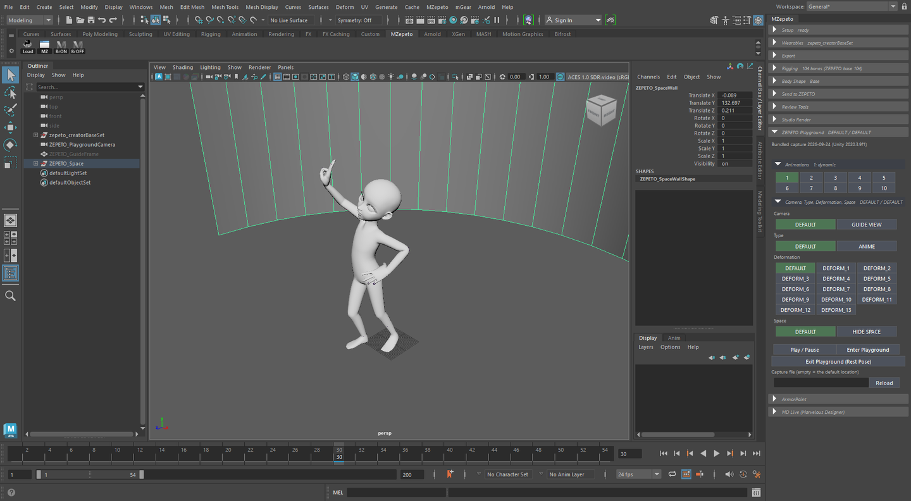

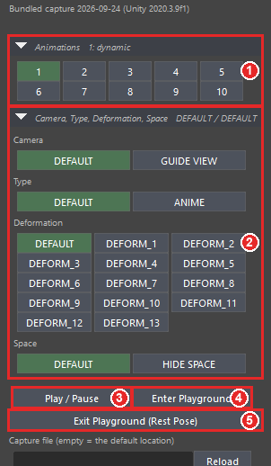

1. **Animations** **①** 에서 애니메이션 번호를 누릅니다
2. **Camera, Type, Deformation, Space** **②** 에서 카메라(DEFAULT / GUIDE VIEW), 체형 타입(DEFAULT / ANIME),
   데포메이션, 스페이스를 고릅니다. 고른 항목은 초록색입니다
3. **Enter Playground** **④** — 카메라, 가이드 프레임, 둥근 벽이 생기고 애니메이션이 캐릭터에 들어갑니다
4. **Play / Pause** **③** — 재생과 멈춤
5. **Exit Playground (Rest Pose)** **⑤** — 키를 지우고 캐릭터를 원래 자세로 되돌립니다. **내보내기는 원래 자세를
   쓰므로**, 캐릭터를 고치기 전에 나오세요

- 플레이그라운드는 함께 들어 있는 캡처로 바로 쓸 수 있습니다. 내 ZEPETO Studio 프로젝트의 캡처를 쓰려면 Unity 에서
  플레이그라운드 씬을 Play 모드로 실행하고 **BZepeto > Capture Playground For Blender** 를 누른 뒤, **Capture file**
  칸에 그 파일을 넣고 **Reload**
- **재생 속도** — 들어갈 때 씬을 클립의 프레임 속도(24·30 fps)로 맞추고, Maya 의 재생 속도가 제한 없음(Play every
  frame, Max Free — Maya 2027 기본값)이면 **실시간으로 제한**합니다. 그래서 애니메이션이 원래 속도로 재생됩니다.
  나오면(Exit) 씬의 원래 프레임 속도와 재생 설정으로 돌아갑니다

## 12. ArmorPaint 와 MD Live

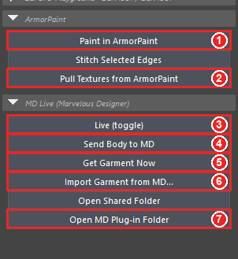

**ArmorPaint**

1. 아이템을 선택하고 **Paint in ArmorPaint** **①** — 아이템이 열린 채로 ArmorPaint 가 뜹니다(Setup 의 ArmorPaint
   Executable 필요)
2. 칠한 뒤 **Pull Textures from ArmorPaint** **②** — 텍스처를 가져와 아이템에 연결합니다
3. **Stitch Selected Edges** — 선택한 엣지를 따라 스티치를 ArmorPaint 레이어로 그립니다

ArmorPaint 쪽 사용법: [ArmorPaint](KO_armorpaint.md).

**MD Live (마블러스 디자이너)** — 제페토 캐릭터를 마블러스 디자이너로 보내 옷을 만들고, 완성된 옷을 입힌 상태로
가져옵니다.

처음 한 번만: **Open MD Plug-in Folder** **⑦** 로 플러그인 폴더를 열고, 마블러스 디자이너의 **Plug-in ▸ Plug-in
Manager ▸ Add** 로 `bz_live.py` 를 등록합니다(`bz_load_avatar`, `bz_send_garment` 도 원하면 함께).

- **Live (toggle)** **③** — 켜면 캐릭터가 바뀔 때마다 몸이 다시 보내지고, 마블러스 디자이너가 돌려보낸 옷이 위
  카테고리로 리깅되어 입혀집니다(이전 라이브 옷을 대신함). 마블러스 디자이너에서 Plug-in 메뉴의 `bz_live` 를 한 번 눌러
  두세요
- **Send Body to MD** **④** — 지금 포즈·체형의 몸을 공유 폴더에 보냅니다(마블러스 디자이너에서 `bz_load_avatar`)
- **Get Garment Now** **⑤** — 마블러스 디자이너에서 지금 옷을 바로 받습니다. 마블러스 디자이너에서 `bz_live` 가
  돌고 있지 않으면 그렇다고 알려 줍니다
- **Import Garment from MD...** **⑥** — 마블러스 디자이너에서 `bz_send_garment` 로 저장한 옷을 가져와 입힙니다

!!! note "BZepeto 와 함께 쓴다면"
    마블러스 디자이너는 **Plug-in Manager 에 등록한 폴더**의 설정을 읽습니다. Blender 애드온과 MZepeto 가 각자 플러그인
    폴더를 가지고 있으므로, 둘 다 쓴다면 MD Live Folder 를 같은 폴더로 두세요. 다르면 MZepeto 가 마블러스 디자이너가 실제로
    쓰는 폴더를 따라가고, 그렇다고 한 줄로 알려 줍니다.

단위: 마블러스 디자이너는 밀리미터, Maya 씬은 센티미터라서 MZepeto 가 씬 단위를 읽어 알아서 맞춥니다.

## 13. 버전 정보 (About)

**MZepeto > About / Version** 은 버전, 만든 이, 라이선스, Maya·Python 버전, 플러그인 상태, 설치 폴더와 설정 파일 위치를
보여 줍니다. **Open Install Folder**·**Open Settings Folder** 로 바로 열 수 있습니다. 문의할 때 이 창의 내용을 함께
알려 주세요.

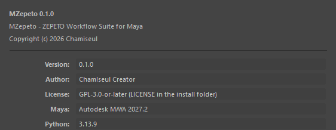

## 14. Python 으로 쓰기

모든 버튼은 Maya 명령이기도 합니다(105개) — 예: `mzepeto_loadBaseCharacter`, `mzepeto_sendItem`,
`mzepeto_autoMask`. 스크립트에서는:

```python
import mzepeto.api as api
api.load_base_character()                         # 베이스 캐릭터
api.load_base_character(face_expressions=True)    # 표정 249개와 함께
api.import_clothing()                             # 옷 불러오기
api.run_checks()                                  # 제페토 검사 (결과 출력)
api.send_item("TOP")                              # 검사 + 내보내기 + Unity 로 보내기
api.bridge_start()                                # Unity 라이브 브리지
```

패널을 코드로 열려면 `from mzepeto.ui import window; window.show()`.

## 15. 문제 해결

| 증상 | 해결 |
|---|---|
| `install.mel` 을 놓아도 아무 일이 없거나 오류 | MZepeto 폴더 경로에 한글이 있는지 확인하세요(2번). Maya 보안 창에서 거부했다면 Maya 를 다시 켜고 Allow |
| MZepeto 메뉴가 사라짐 | **Windows > Settings/Preferences > Plug-in Manager** 에서 `mzepeto_plugin.py` 의 **Loaded**·**Auto load** 를 켜거나, 셸프의 **Load** |
| Load ZEPETO Base Character 가 파일 창을 띄움 | Setup 의 ZEPETO Files Folder 에 `creatorBaseSet_zepeto.fbx` 가 없습니다. Setup 아래 `[ok]` / `[--]` 를 확인하세요 |
| 캐릭터가 엄청 크게 보임 | 씬 단위가 미터입니다. Working Units > Linear 를 centimeter 로(5번) |
| 플레이그라운드 애니메이션이 너무 빠름 | 이 버전은 Enter Playground 가 재생 속도를 실시간으로 제한합니다. 직접 바꾸려면 Preferences > Time Slider > **Playback speed** 를 Real-time 또는 Max Playback Speed 를 Real-time 으로 |
| 패널이 화면 밖에 있거나 찾을 수 없음 | **MZepeto > Open MZepeto Window** 를 다시 누르면 앞으로 나옵니다 |
| Get Garment Now 가 반응 없음 | 마블러스 디자이너에서 `bz_live` 가 돌고 있는지, MD Live Folder 가 마블러스 디자이너 플러그인과 같은 폴더인지(12번) |

더 많은 질문은 [도움말·FAQ](KO_help.md)에 있습니다(Unity·ArmorPaint·제페토 심사 내용은 BZepeto 와 같습니다).

© 2026 Chamiseul
